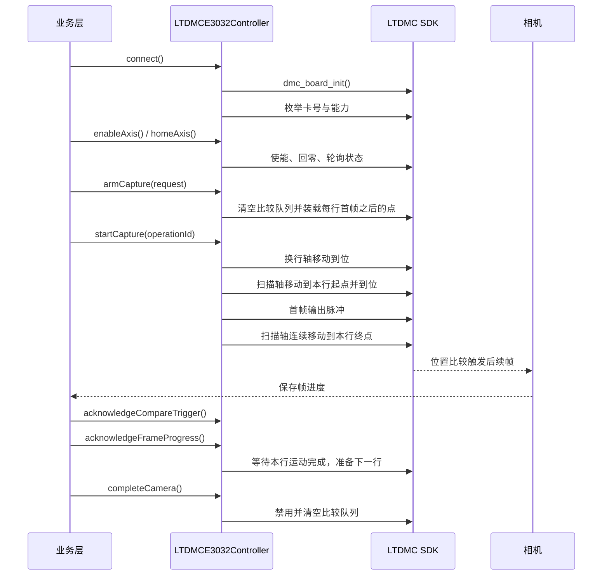

# DMC 控制器接口与硬件时序

## 控制器选择

通过 `DmcControllerFactory::create()` 创建控制器。`DmcConfig::simulation` 为 `true` 时由工厂创建 `SimulatedDmcController`；硬件配置由 `LTDMCE3032Controller` 负责。硬件适配器不包含仿真分支。

```cpp
SZX::DMC::DmcConfig config;
config.model = SZX::DMC::DmcModel::LeiSaiLTDMC;
config.profileId = "E3032";
config.cardIndex = 0;                 // 板卡枚举索引，不是 SDK 卡号
config.simulation = false;

auto controllerResult = SZX::DMC::DmcControllerFactory::create(config);
```

硬件连接时使用全局 `dmc_board_init()`，根据枚举结果将 `cardIndex` 映射到实际卡号，并检查轴数、输入数和输出数。最后一个控制器断开后才调用全局 `dmc_board_close()`。

## 基本使用顺序

1. `connect()`。
2. 对扫描轴和换行轴分别调用 `enableAxis()`。
3. 调用 `homeAxis()`，通过 `status()` 或 `pollCapture()` 等待 `homing=false, homed=true`。
4. 运动前确认轴已使能、已回零，且轴错误码和总线错误码均为零。
5. 构造 `CaptureRequest` 并调用 `armCapture()`。
6. 使用允许的 `StartSource` 调用 `startCapture()`。
7. 相机保存帧后调用 `acknowledgeFrameProgress()`；硬件比较触发由 `acknowledgeCompareTrigger()` 确认。
8. 所有帧保存且触发条件满足后调用 `completeCamera()`。
9. 异常流程调用 `failCapture()` 或 `cancelCapture()`，最后调用 `disconnect()`。

`ComparePoint::position`、扫描起止位置和行位置均使用 LTDMC 的控制器单位，适配器调用对应的 `_unit` SDK 接口。输入事件只提供原始电平，急停、光栅等业务安全含义由上层流程解释。

## 位置比较采集时序



每行第一帧由适配器在扫描起点发出软件脉冲，位置比较队列只装载该行后续帧。因此位置比较触发计数不等于总帧数，完成条件为“首帧数 + 已确认比较触发数”覆盖全部帧。

## 软件触发采集

`FrameTriggerSource::Software` 不启用位置比较队列。每次帧进度增加时，适配器输出一次有效电平并保持约 1 ms 后恢复无效电平；相机保存进度仍需由业务层通过 `acknowledgeFrameProgress()` 提交。

## 失败和清理

- 回零超过 60 秒、轴错误、总线错误或运动完成轮询失败时，操作进入失败状态。
- 急停使用 `dmc_emg_stop()`；减速停止按轴调用 `dmc_stop(..., 0)`。
- 采集失败、取消、完成和断开都会禁用并清空位置比较队列。
- 输入轮询线程只负责原始输入、轴位置、运动完成和错误状态采样，不执行业务回调之外的业务安全决策。
