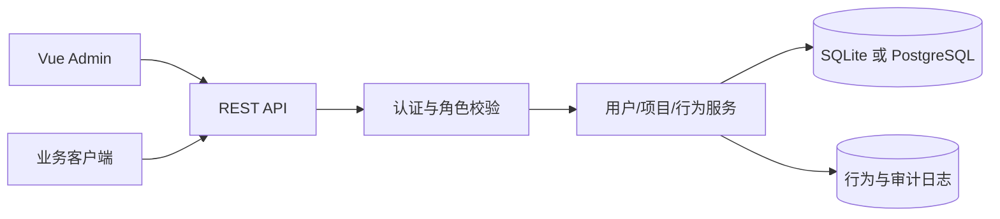

# 单项目 RABC 用户管理系统设计

## 1. 版本目标

首版只服务一个项目实例，提供用户创建、启停、角色分配和操作记录。暂不支持多项目、组织树、自定义权限组合、权限组或数据行级权限。

## 2. 固定角色

| 角色 | 定位 |
|---|---|
| 操作员 | 执行日常业务操作 |
| 工程师 | 操作员权限 + 工程配置/诊断 |
| 管理员 | 用户管理、角色分配、项目配置 |
| 超管 | 全部管理能力，负责初始化和管理员维护 |

首版采用固定角色到能力的映射，用户只能选择一个角色。角色不可自定义、不可组合；后续再迭代权限明细和权限组。

## 3. 总体架构

单体服务即可满足首版；Admin 与 Client 通过路由前缀区分。所有鉴权在后端完成，前端菜单隐藏仅用于体验。

## 4. 首次初始化

部署时生成一个超管账号。超管首次登录强制修改密码；默认进入用户管理页面。没有业务用户时显示空列表和创建引导。超管可以创建、编辑、禁用管理员及其他用户。

## 5. 访问规则

管理员和超管可访问用户管理；工程师和操作员只能访问被角色允许的业务页面；未登录或禁用用户拒绝访问。所有角色变更、登录和关键业务操作写入日志。
