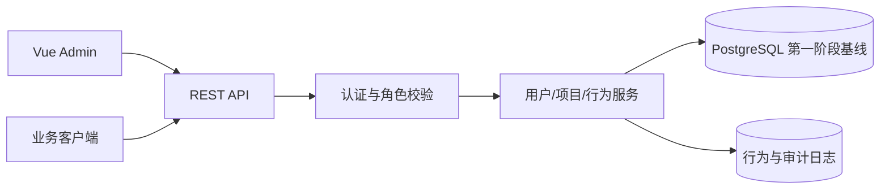

# 单项目 RBAC 用户管理系统设计

## 1. 版本目标

第一阶段只服务一个项目实例，提供用户初始化、登录/退出、首次改密、用户创建与编辑、启用/禁用、固定角色分配、权限查询和安全审计。第一阶段必须能通过[第一阶段验收清单](06-第一阶段验收清单.md)。

暂不支持多项目、组织树、自定义权限组合、权限组、数据行级权限、项目配置中心、系统重置、SSO/MFA 和在线吊销服务。

## 2. 固定角色

| 角色 | 定位 |
|---|---|
| 操作员 | 执行日常业务操作 |
| 工程师 | 操作员权限 + 工程配置/诊断 |
| 管理员 | 管理操作员/工程师用户；不能管理管理员或超管 |
| 超管 | 全部用户管理能力，负责初始化和管理员维护 |

第一阶段采用固定角色到能力的映射，用户只能拥有一个角色。角色不可自定义、不可组合；后续再迭代权限明细和权限组。

角色能力码由后端维护，客户端只能读取，不能提交或修改。后端以用户当前数据库状态为准，不信任 JWT 或客户端提交的角色。

## 3. 总体架构



单体服务即可满足第一阶段；Admin 与 Client 通过路由前缀区分，并在 token 中使用明确的 issuer/audience。所有鉴权在后端完成，前端菜单隐藏仅用于体验。

## 4. 首次初始化

部署时通过受控的一次性 bootstrap 流程生成一个超管账号，不使用固定默认密码。bootstrap 必须幂等，凭据只通过部署环境安全通道交付；超管首次登录强制修改密码。

初始超管创建后，系统默认进入用户管理页面。没有业务用户时显示空列表和创建引导。超管可以创建、编辑、启用/禁用管理员及其他用户，但任何操作都不能移除最后一个 active 超管。第一阶段不提供项目配置中心或系统重置接口。

## 5. 访问规则

管理员和超管可访问用户管理；工程师和操作员只能访问被角色允许的业务页面；未登录、disabled 或 locked 用户拒绝访问。所有角色变更、登录、密码/会话操作、状态变化和关键 Client 业务事件写入日志。

管理员只能创建、编辑、启停、解锁和重置操作员/工程师；只有超管可以创建或管理管理员/超管以及执行角色升级。管理员不能修改超管。禁止禁用、降级或并发移除最后一个 active 超管；这些检查必须在同一事务中完成。

账户状态转换：

```text
active   -> disabled   (管理员/超管按目标权限)
disabled -> active     (管理员/超管按目标权限)
active   -> locked     (登录失败策略自动触发)
locked   -> active     (管理员/超管按目标权限明确解锁；锁定期满不会自动解锁)
```

密码修改、角色变更、禁用和解锁会递增会话/授权版本，使已有 access token 按服务端策略失效。密码、token、私钥和原始机器标识不得进入日志。

Client 登录后可查询当前用户的固定角色和能力码，用于客户端菜单、按钮和业务流程判断；实际业务接口仍由后端再次鉴权。客户端行为埋点只作为非可信业务 telemetry，不能替代服务端安全审计。
